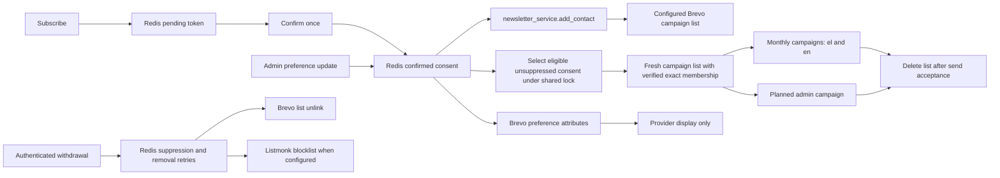

# Newsletter consent and delivery (#261)

`newsletter:confirmed` in Redis stores local records. Only validated DOI evidence
authorizes delivery; `reconfirm_pending` records and pending signup tokens
are not consent. Confirmation preserves the requested preferences and DOI
evidence; backfill never invents timestamps or changes that evidence.

Brevo is the campaign delivery provider. Contact enrollment uses `BREVO_LIST_ID`,
with the existing list default. Monthly reports and admin campaigns each target a fresh temporary list built
from authoritative Redis consent under the shared newsletter lock.
`BREVO_API_KEY` remains server-side. Listmonk is an optional secondary provider.
List membership does not replace consent or override provider suppression.

The self-hosted list service uses `LISTMONK_URL`, defaulting to the Compose
service name `http://listmonk:9000`. Keep a stable service hostname: container
IPs can change on recreate. A configured raw IPv4 host produces one warning
per API process; the warning never includes the URL or credentials.

Create a dedicated **API user** in Listmonk's Admin → Users screen and generate
its API token. The existing environment variable names remain for compatibility:
`LISTMONK_ADMIN_USER` must contain that API username and
`LISTMONK_ADMIN_PASSWORD` must contain its API token, **not the admin login or
password**. The integration sends this username/token pair with HTTP Basic auth.
An unset token keeps the optional integration disabled. See the official
[API authentication documentation](https://listmonk.app/docs/apis/apis/#auth).

As an operator step, assign only subscriber and list subscription permissions:
get subscribers (`subscribers:get`, `subscribers:get_all`), manage subscribers
(`subscribers:manage`, including blocklisting), query subscribers
(`subscribers:sql_query`, required by the withdrawal and re-confirmation
lookups; without it these calls fail with 403), and a list role with manage
access to the configured newsletter lists for subscription changes. Do not
grant settings, campaign, user/role administration or Super Admin permissions.
See [Listmonk roles and permissions](https://listmonk.app/docs/roles-and-permissions/).
The application does not create users or modify provider roles.

HTTP 401/403 responses log one actionable, fixed message per API process:
configure an API user and API token with the required permissions. The log and
public errors omit identities, credentials and provider response bodies.
Authentication failures preserve the existing fail-safe behavior: definite
enrollment rejections remain retryable, and queued removals retain their retry
markers. Correct the credentials/permissions and retry the existing operation;
do not clear consent, suppression or retry state to work around authentication.

For an optional connection check, call the existing authenticated
`GET /api/v1/admin/newsletter/readiness?check_list_service=true` using the same
admin bearer authentication described below. It adds only `list_service`
counts: `configured`, `reachable` and `failed` (each 0 or 1). It performs at most
one subscriber GET with a five-second budget and discards subscriber data.
An unset token returns all zeros without a provider request. Connection,
authentication and malformed-response failures set `failed=1` without exposing
provider details. The check runs only when requested, never during API startup;
the default readiness output is unchanged. It does not authorize delivery or
change the consent audit's existing blockers.

The boundary covered by this change is:

A new confirmation attempts enrollment only with validated schema-2 double-opt-in
evidence (timezone-aware request/click timestamps in order, within 24 hours,
neither in the future) and at least one enabled topic in a valid topic map.
The explicit legacy reconfirmation flow below permits a 30-day click window.
Legacy/incomplete evidence and all-disabled topics never authorize enrollment;
apply backfill removes their existing delivery memberships while retaining
the consent record for review. Confirmation still succeeds when delivery or
the post-save suppression lookup fails; backfill handles reconciliation.
It queues an internal
`newsletter:brevo:add_retry` marker before the provider call and clears it on
success. Enrollment syncs language, frequency and all five topic attributes,
including explicit false values, even for an existing list member. Failure keeps
the consent and the public confirmation response;
only a fixed, redacted error is logged. Consumed links do not repeat enrollment.
Reconcile through the admin backfill; no background sync job is introduced.

Brevo's bearer-authenticated webhook propagates `unsubscribed` / `unsubscribe`,
`hardBounce` / `hard_bounce`, `spam` and `complaint` events, covering both
transactional and campaign spellings. Operators can also record a withdrawal with
`POST /api/v1/newsletter/unsubscribe` and an email field in its JSON body.
This endpoint requires the existing admin bearer authentication; public
withdrawals use Brevo's unsubscribe flow and authenticated event webhook.

Withdrawal atomically records `newsletter:suppressed`, removes active Redis
consent, cancels pending additions and queues provider removals. Brevo is
unlinked from the configured list, retaining its contact/suppression history;
Listmonk matches the exact address and blocklists it when configured. Repeated
withdrawals are safe. Failed removals remain in `newsletter:brevo:remove_retry`
and `newsletter:listmonk:remove_retry` until retried. Local/provider suppression
wins over confirmation and backfill; no blacklist or unsubscribe flag is reset.
An in-flight addition checks withdrawal again and compensates with removal.
`newsletter:brevo:add_unsettled` and `newsletter:listmonk:add_unsettled`
serialize additions per case-insensitive identity
and record `pending` before the provider request. Failure/timeout records
`uncertain`; withdrawal never cancels this marker. Removal work remains durable
while a request is pending, and an absent contact cannot resolve uncertainty.
After an uncertain add, backfill must observe the Brevo membership or Listmonk
contact and acknowledge its removal/blocklisting before clearing removal work.
Listmonk's bulk blocklist success alone cannot establish that a contact exists.
For an eligible, unsuppressed Brevo contact,
matching current attributes can retire display sync work without another write.
This is not evidence that a specific historical request settled, and none of
these markers or provider attributes authorize campaign dispatch.
Repeated absence retains the work for later backfills; a process crash leaving
`pending`, or a failed write that never commits, requires operator reconciliation
with provider evidence before clearing the unsettled marker. No elapsed-time
assumption allows suppression to be bypassed.

Brevo suppression detected during confirmation or apply backfill is persisted
as `provider_suppressed` in Redis and queues withdrawal from both providers.
Confirmation attempts Listmonk enrollment only after successful Brevo sync;
suppression persistence failures therefore cannot enable the secondary provider.
Dry-run backfill remains read-only, including when it detects suppression.

Webhook withdrawals are persisted before event counters or cache invalidation,
including every withdrawal in a batch. Persistence failures return HTTP 429
with `Retry-After: 600`: [Brevo's retry policy](https://developers.brevo.com/docs/retry-mechanism)
discards 5xx responses and retries 429. Operator unsubscribe returns HTTP 503
on persistence failure. A provider removal failure can return success only
after durable suppression and retry work exist. Statistics failures cannot
discard withdrawal work. Newsletter validation errors return a fixed 422
without submitted values, and HTTP transport debug header logs are suppressed.

`POST /api/v1/admin/newsletter/backfill` requires
`Authorization: Bearer <ADMIN_KEY>`. Its `dry_run` query parameter defaults to
`true`: read confirmed consent and Brevo state, perform no writes, and return
only `to_add`, `already_present`, `held`, and `failed` counts. Records without
validated DOI evidence or an enabled, valid topic map count as `held`, with no
identities in the report. Suppressed, invalid and unreadable records count as
failed. `?dry_run=false` retries queued withdrawals and removes ineligible
delivery memberships, then reconciles confirmed contacts; successful additions
count as `to_add` (including preference updates to existing members) and
failed removals also count as `failed` (including removal work for held records).
Repeating apply reports successful
members as already present. Pending signups and provider-only contacts are
outside the backfill scope. Responses/logs contain no contact identities or
credentials.

Legacy records without validated DOI evidence can receive one fresh, neutral
Greek confirmation invitation through
`POST /api/v1/admin/newsletter/reconfirm`. This uses the same admin bearer
authentication as backfill. `dry_run=true` is the default, including when
`resend=true` is supplied: it reads local and provider state, performs no writes
or sends, and returns only `selected`, `pending`, `paused`, `sent`, `skipped`,
and `failed` counts. The selection is the valid local identity subset held by
backfill for missing DOI evidence; records with valid evidence but no topics
are outside this flow. Local withdrawals, Brevo suppression and Listmonk
blocklists/unsubscribed newsletter memberships exclude invitations. Unreadable
provider state cannot authorize an invitation.

`?dry_run=false` atomically marks each selected local record as
`consent_state=reconfirm_pending` with an aware `reconfirm_created_at`. It stores
a matching lifecycle entry under `newsletter:reconfirm`, keyed by normalized
identity. The lifecycle and token records persist SHA-256 token digests, never
the bearer token itself. It then unlinks the configured Brevo campaign list and,
when configured, Listmonk's newsletter lists, retaining the provider contacts
and their suppression history. Durable removal retries use the existing queues;
reconfirmation pauses unlink Listmonk memberships instead of blocklisting.
The transactional invitation is sent only after both pauses succeed. It uses
the existing transactional sender and Reply-To, a single confirmation link,
and a notice that no further emails are sent without confirmation and the
newsletter record is deleted after 30 days. It contains no campaign content or
promotional footer links.

An existing pending token prevents automatic resends, including after an
ambiguous SMTP outcome or a crash. The send attempt is claimed atomically
before SMTP. Repeating apply retries the pause but does not send again.
An intentional `?dry_run=false&resend=true` rotates and invalidates the previous
token. Resend retains the original creation time and deletion deadline; it
cannot revive an expired invitation. A pause or send failure therefore requires
an explicit resend after the provider issue is resolved.

The invitation uses the existing public `/api/v1/newsletter/confirm/{token}`
route. The token is single use and expires at the original 30-day deadline.
The click atomically replaces the exact pending legacy record with schema-2
DOI evidence, aware `requested_at` and `confirmed_at`, and
`confirmation_source=legacy_reconfirmation`. This source has a 30-day evidence
window; ordinary signup evidence retains its 24-hour window. Saved preferences
are preserved. At least one enabled topic in a valid topic map is still required
before the normal Brevo enrollment path runs. A withdrawal, expiry, rotated
token or repeated click cannot restore the legacy record or repeat enrollment.

`POST /api/v1/admin/newsletter/reconfirm/expire` also requires admin bearer auth
and defaults to `dry_run=true`. It reports only `expired`, `deleted`, `pending`,
and `failed` counts. Apply deletes expired legacy consent and its token before
provider cleanup, retaining a minimal `reconfirm_expiring` removal ledger until
both providers acknowledge removal. Failures remain retryable; repeated expiry
is safe, and successful fresh confirmations are outside its scope. `deleted`
counts completed cleanup operations. Provider cleanup unlinks newsletter lists;
legacy records have no reliable provider-contact ownership evidence, so shared
provider contacts and suppression history are retained.

The existing APScheduler registers `newsletter_reconfirm_expiry` daily at
03:00 UTC, using the existing cross-worker lease and observed-job wrapper.
It calls the same expiry operation with `dry_run=false`, catches failures, and
logs aggregate counts or a fixed error message only. It sends no reminders.
Monthly and admin campaign send paths reconcile pending/expiring pauses before
sending and fail closed if Redis or provider removal is unavailable. Backfill
also treats pending reconfirmations as ineligible. Newsletter validation and
availability failures remain fixed 422/503 responses; addresses and bearer
tokens are absent from operation responses and logs, and the existing access-log
and Sentry confirmation-token scrubbers cover the reused public link route.

This documents the implemented handoff, superseding the historical no-writer
inventory in [the delivery audit](newsletter-delivery-audit.md). Campaign
content remains separate work.

Campaign dispatch and preferences (#667, #683)
--------------------------------------------

Redis consent authorizes campaigns. Provider segments, attributes and enrollment
list membership do not authorize sending. Under the shared renewable newsletter
lock, each send computes eligible identities from DOI evidence, suppression,
withdrawal intent, reconfirmation state, language, cadence and topics. Native
provider suppression is also respected; failed provider lookups abort dispatch.
An eligible contact need not already belong to the enrollment list. A missing
provider contact will fail the temporary-list add and abort the campaign.

Both admin and monthly sends create a unique empty static Brevo list in the
same folder as `BREVO_LIST_ID`. The name is
`newsletter-tmp-v1-<UTC epoch seconds>-<random UUID hex>`. Only the campaign
preparation code writes these lists. Preference syncs and withdrawal cleanup
continue to use the enrollment list and cannot add anyone to a temporary list.
Adds use at most 150 addresses per request and are idempotent. Every member page
is read and the raw set and count must exactly match the authorized identities;
extra, missing, duplicate or malformed members abort the send. The campaign is
also read back to verify it targets only that list, with no residual segments
or other recipient filters. The bound is
10,000 local consent records and 10,000 members per temporary list.

The lock is held through list preparation, campaign targeting, final consent,
list and lease checks, `sendNow`, and deletion. A queued withdrawal records
`newsletter:withdrawal_pending` before attempting the lock. If it concerns a
selected identity before dispatch, the send aborts and deletes its temporary
list. The withdrawal request receives a retry response on contention; the
intent persists until durable suppression succeeds. Never clear this intent to
unblock a campaign: retry the withdrawal instead. Withdrawal persistence and
ordinary preference writes remain serialized by the same lock. Once `sendNow`
has started, mail accepted by the provider cannot be recalled.

Both send paths share the durable `newsletter:dispatch:v1` ledger. It records
the provider campaign ID alongside the logical monthly month/language or admin
request key. A monotonic fencing counter is checked atomically against the
lease, logical record and shared campaign record immediately before `sendNow`.
An existing `claimed`, `uncertain` or `sent` campaign blocks every other path,
including older logical records without the shared campaign index. Only a
definitely failed attempt can acquire a new fence and retry the same draft.
Uncertain claims require manual review; even a provider `sent` response does
not automatically settle them. Authenticated
`GET /api/v1/admin/newsletter/dispatch-status` reports read-only counts, counting
each provider campaign once without exposing IDs or request keys. It does not
release claims or authorize retries.

Failures before dispatch abort and attempt deletion in `finally`. Send rejection
or timeout also attempts deletion and returns failure; the code never retries an
uncertain send automatically. Successful provider acceptance is followed by
list deletion without deleting contacts or suppression history. A deletion
failure after acceptance is logged as counts, without reporting the send as
failed or sending it again. Provider acceptance is the boundary specified by
this integration; these tests use a mocked provider and do not prove downstream
Brevo delivery timing.

The observed scheduler job `newsletter_list_cleanup` runs hourly at minute 15
UTC, under the shared newsletter lock. It discovers temporary lists directly
from Brevo, including lists whose creation response was lost, and deletes only
strictly matching owned names older than 24 hours. It collects all pages before
mutation and retains failed deletions for the next run. It never deletes the
enrollment list or ordinary operator lists. Review scheduler failures and
`temporary_list_cleanup_failed` counts; rerun
`services.newsletter_dispatch.cleanup_temporary_campaign_lists()` in the API
runtime to retry cleanup. No address export is needed.

No segment setup is required. `BREVO_NEWSLETTER_SEGMENTS` may remain in existing
environments; the legacy parser remains available for compatibility but neither
campaign path consults it. Missing, empty or invalid legacy values cannot select
a dispatch target. Provider attributes may remain useful for display:
`NL_LANGUAGE`, `NL_MONTHLY`, `NL_WEEKLY` and the five `NL_<TOPIC>` booleans.
Backfill can synchronize those attributes without authorizing delivery or
changing DOI evidence. Uncertain historical provider writes cannot broaden the
fresh list, even when matching current attributes conceals an older update.

See Brevo's official [list creation](https://developers.brevo.com/reference/create-list),
[batch membership](https://developers.brevo.com/reference/add-contact-to-list),
[list contacts](https://developers.brevo.com/reference/get-contacts-from-list)
and [list deletion](https://developers.brevo.com/reference/delete-list) APIs.

The saved frequency is a maximum cadence:

| Saved value | Monthly campaign | Weekly campaign |
| --- | --- | --- |
| `monthly` | included | excluded |
| `weekly` | included | included |
| missing or unknown | excluded | excluded |

Language `en` receives English campaigns; `el`, missing and unknown language use
Greek. The consent record itself is preserved. Each topic-specific campaign
requires that exact topic to be true. A general digest (`topic=null`) requires
at least one topic, alongside the existing valid topic-map and DOI checks.
The scheduled digest produces separate Greek and English campaigns; generated
labels, subjects and links follow the language, and bill titles use `title_en`
for English, with the neutral label “Bill” when a translation is absent.

`PUT /api/v1/admin/newsletter/preferences` uses the existing admin bearer auth.
Its body contains `email`, `language`, `frequency` and the complete `topics` map.
It updates existing DOI consent atomically, queues sync before provider I/O and
returns only `updated`, `synced`, `failed` counts. Missing, withdrawn, ambiguous
case aliases and legacy records are not granted consent by this operation. All
topics disabled removes delivery memberships. A failed sync retains saved
preferences and retry work for backfill. Withdrawal still wins over an in-flight
update and retains the existing durable removal semantics.

`POST /api/v1/admin/newsletter/audience` is an authenticated dry-run endpoint.
Its body is a planned campaign, for example
`{"language":"en","frequency":"weekly","topic":"active_votes"}`.
Defaults are Greek, monthly and a general digest. It performs Redis/provider
reads only and returns `selected`, `excluded`, `failed` counts: selected counts
unique, locally eligible, unsuppressed identities using current local preferences;
excluded covers ineligible/nonmatching/provider-suppressed records; failed
covers unknown provider state and ambiguous aliases. It reads only
locally confirmed identities, so provider-only contacts are never candidates.
The estimate is not a send reservation and does not depend on segment setup.

Admin `/draft` accepts the same plan fields alongside subject/content. The
provider draft stores the plan in a versioned `tag`. `/send` reads that stored
plan, creates and targets its isolated list, and rechecks consent and the exact
list membership before dispatch. Drafts have no recipients until send
preparation. Old drafts lacking a valid plan must be recreated. Send output
contains only `selected`, `sent` and `telegram_sent` counts; an empty audience
returns zero selected/sent without dispatch or cross-publishing.

Both send paths return reason codes and aggregate counts only. Empty audiences
create no temporary list, send no campaign and do not cross-publish. The read-only
readiness audit remains conservative about provider history; the planned
audience endpoint estimates current campaign eligibility without provider writes.

Provider operations follow the official
[Brevo list removal API](https://developers.brevo.com/reference/remove-contact-from-list)
and [Listmonk subscriber API](https://listmonk.app/docs/apis/subscribers/);
campaign event names follow [Brevo marketing webhooks](https://developers.brevo.com/docs/marketing-webhooks).
