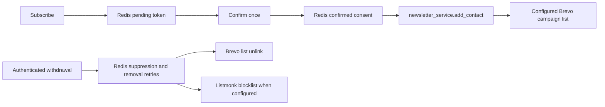

# Newsletter consent and delivery (T-9158 / #261)

`newsletter:confirmed` in Redis is the consent record. Pending signup tokens
are not consent. Confirmation preserves the requested preferences and DOI
evidence; backfill never invents timestamps or changes that evidence.

Brevo is the campaign delivery list. Contact enrollment, monthly reports and
admin campaigns share `BREVO_LIST_ID`, with the existing list default.
`BREVO_API_KEY` remains server-side. Listmonk is an optional secondary provider.
List membership does not replace consent or override provider suppression.

The boundary covered by this change is:

A new confirmation attempts enrollment only with validated schema-2 double-opt-in
evidence (timezone-aware request/click timestamps in order, within 24 hours,
neither in the future) and at least one enabled topic in a valid topic map.
Legacy/incomplete evidence and all-disabled topics never authorize enrollment;
apply backfill removes their existing delivery memberships while retaining
the consent record for review. Confirmation still succeeds when delivery or
the post-save suppression lookup fails; backfill handles reconciliation.
It queues an internal
`newsletter:brevo:add_retry` marker before the provider call and clears it on
success. Failure keeps the consent and the public confirmation response;
only a fixed, redacted error is logged. Consumed links do not repeat enrollment.
Reconcile through the admin backfill; no background sync job is introduced.

Brevo's bearer-authenticated webhook propagates `unsubscribed` / `unsubscribe`,
`hardBounce` / `hard_bounce`, `spam` and `complaint` events, covering both
transactional and campaign spellings. Operators can also record a withdrawal with
`POST /api/v1/newsletter/unsubscribe` and an email field in its JSON body.
This endpoint requires the existing admin bearer authentication; public
withdrawals use Brevo's unsubscribe flow and authenticated event webhook.

Withdrawal atomically records `newsletter:suppressed`, removes active Redis
consent, cancels pending additions and queues provider removals. Brevo is
unlinked from the configured list, retaining its contact/suppression history;
Listmonk matches the exact address and blocklists it when configured. Repeated
withdrawals are safe. Failed removals remain in `newsletter:brevo:remove_retry`
and `newsletter:listmonk:remove_retry` until retried. Local/provider suppression
wins over confirmation and backfill; no blacklist or unsubscribe flag is reset.
An in-flight addition checks withdrawal again and compensates with removal.
`newsletter:brevo:add_unsettled` serializes additions per case-insensitive identity
and records `pending` before the provider request. Failure/timeout records
`uncertain`; withdrawal never cancels this marker. Removal work remains durable
while a request is pending, and an absent contact cannot resolve uncertainty.
After an uncertain add, backfill must observe membership and acknowledge its
removal before clearing removal work. For an eligible, unsuppressed contact,
observing membership reconciles the original addition without sending another.
Repeated absence retains the work for later backfills; a process crash leaving
`pending`, or a failed write that never commits, requires operator reconciliation
with provider evidence before clearing the unsettled marker. No elapsed-time
assumption allows suppression to be bypassed.

Webhook withdrawals are persisted before event counters or cache invalidation,
including every withdrawal in a batch. Persistence failures return HTTP 429
with `Retry-After: 600`: [Brevo's retry policy](https://developers.brevo.com/docs/retry-mechanism)
discards 5xx responses and retries 429. Operator unsubscribe returns HTTP 503
on persistence failure. A provider removal failure can return success only
after durable suppression and retry work exist. Statistics failures cannot
discard withdrawal work. Newsletter validation errors return a fixed 422
without submitted values, and HTTP transport debug header logs are suppressed.

`POST /api/v1/admin/newsletter/backfill` requires
`Authorization: Bearer <ADMIN_KEY>`. Its `dry_run` query parameter defaults to
`true`: read confirmed consent and Brevo state, perform no writes, and return
only `to_add`, `already_present`, `held`, and `failed` counts. Records without
validated DOI evidence or an enabled, valid topic map count as `held`, with no
identities in the report. Suppressed, invalid and unreadable records count as
failed. `?dry_run=false` retries queued withdrawals and removes ineligible
delivery memberships, then reconciles confirmed contacts; successful additions
count as `to_add` and
failed removals also count as `failed` (including removal work for held records).
Repeating apply reports successful
members as already present. Pending signups and provider-only contacts are
outside the backfill scope. Responses/logs contain no contact identities or
credentials.

This documents the implemented handoff, superseding the historical no-writer
inventory in [the delivery audit](newsletter-delivery-audit.md). Campaign
content remains separate work.

Known limitation and follow-up: language, frequency and topic audience
segmentation are OUT OF SCOPE for this PR. Monthly reports and admin campaigns
currently target the same configured Brevo list; they do not filter recipients
or content by those saved preferences. Having at least one enabled topic grants
list eligibility only, and does not mean those choices are enforced by campaigns.
The integrator will file the follow-up issue to implement and test audience
selection for language, frequency and topics across both campaign send paths.
The read-only readiness report continues to flag this delivery limitation.

Provider operations follow the official
[Brevo list removal API](https://developers.brevo.com/reference/remove-contact-from-list)
and [Listmonk subscriber API](https://listmonk.app/docs/apis/subscribers/);
campaign event names follow [Brevo marketing webhooks](https://developers.brevo.com/docs/marketing-webhooks).
