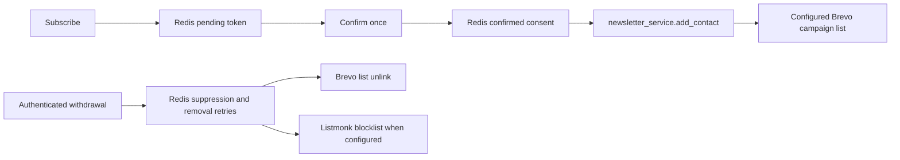

# Newsletter consent and delivery (#261)

`newsletter:confirmed` in Redis stores local records. Only validated DOI evidence
authorizes delivery; `reconfirm_pending` records and pending signup tokens
are not consent. Confirmation preserves the requested preferences and DOI
evidence; backfill never invents timestamps or changes that evidence.

Brevo is the campaign delivery list. Contact enrollment, monthly reports and
admin campaigns share `BREVO_LIST_ID`, with the existing list default.
`BREVO_API_KEY` remains server-side. Listmonk is an optional secondary provider.
List membership does not replace consent or override provider suppression.

The boundary covered by this change is:

A new confirmation attempts enrollment only with validated schema-2 double-opt-in
evidence (timezone-aware request/click timestamps in order, within 24 hours,
neither in the future) and at least one enabled topic in a valid topic map.
The explicit legacy reconfirmation flow below permits a 30-day click window.
Legacy/incomplete evidence and all-disabled topics never authorize enrollment;
apply backfill removes their existing delivery memberships while retaining
the consent record for review. Confirmation still succeeds when delivery or
the post-save suppression lookup fails; backfill handles reconciliation.
It queues an internal
`newsletter:brevo:add_retry` marker before the provider call and clears it on
success. Failure keeps the consent and the public confirmation response;
only a fixed, redacted error is logged. Consumed links do not repeat enrollment.
Reconcile through the admin backfill; no background sync job is introduced.

Brevo's bearer-authenticated webhook propagates `unsubscribed` / `unsubscribe`,
`hardBounce` / `hard_bounce`, `spam` and `complaint` events, covering both
transactional and campaign spellings. Operators can also record a withdrawal with
`POST /api/v1/newsletter/unsubscribe` and an email field in its JSON body.
This endpoint requires the existing admin bearer authentication; public
withdrawals use Brevo's unsubscribe flow and authenticated event webhook.

Withdrawal atomically records `newsletter:suppressed`, removes active Redis
consent, cancels pending additions and queues provider removals. Brevo is
unlinked from the configured list, retaining its contact/suppression history;
Listmonk matches the exact address and blocklists it when configured. Repeated
withdrawals are safe. Failed removals remain in `newsletter:brevo:remove_retry`
and `newsletter:listmonk:remove_retry` until retried. Local/provider suppression
wins over confirmation and backfill; no blacklist or unsubscribe flag is reset.
An in-flight addition checks withdrawal again and compensates with removal.
`newsletter:brevo:add_unsettled` and `newsletter:listmonk:add_unsettled`
serialize additions per case-insensitive identity
and record `pending` before the provider request. Failure/timeout records
`uncertain`; withdrawal never cancels this marker. Removal work remains durable
while a request is pending, and an absent contact cannot resolve uncertainty.
After an uncertain add, backfill must observe the Brevo membership or Listmonk
contact and acknowledge its removal/blocklisting before clearing removal work.
Listmonk's bulk blocklist success alone cannot establish that a contact exists.
For an eligible, unsuppressed Brevo contact,
observing membership reconciles the original addition without sending another.
Repeated absence retains the work for later backfills; a process crash leaving
`pending`, or a failed write that never commits, requires operator reconciliation
with provider evidence before clearing the unsettled marker. No elapsed-time
assumption allows suppression to be bypassed.

Brevo suppression detected during confirmation or apply backfill is persisted
as `provider_suppressed` in Redis and queues withdrawal from both providers.
Confirmation attempts Listmonk enrollment only after successful Brevo sync;
suppression persistence failures therefore cannot enable the secondary provider.
Dry-run backfill remains read-only, including when it detects suppression.

Webhook withdrawals are persisted before event counters or cache invalidation,
including every withdrawal in a batch. Persistence failures return HTTP 429
with `Retry-After: 600`: [Brevo's retry policy](https://developers.brevo.com/docs/retry-mechanism)
discards 5xx responses and retries 429. Operator unsubscribe returns HTTP 503
on persistence failure. A provider removal failure can return success only
after durable suppression and retry work exist. Statistics failures cannot
discard withdrawal work. Newsletter validation errors return a fixed 422
without submitted values, and HTTP transport debug header logs are suppressed.

`POST /api/v1/admin/newsletter/backfill` requires
`Authorization: Bearer <ADMIN_KEY>`. Its `dry_run` query parameter defaults to
`true`: read confirmed consent and Brevo state, perform no writes, and return
only `to_add`, `already_present`, `held`, and `failed` counts. Records without
validated DOI evidence or an enabled, valid topic map count as `held`, with no
identities in the report. Suppressed, invalid and unreadable records count as
failed. `?dry_run=false` retries queued withdrawals and removes ineligible
delivery memberships, then reconciles confirmed contacts; successful additions
count as `to_add` and
failed removals also count as `failed` (including removal work for held records).
Repeating apply reports successful
members as already present. Pending signups and provider-only contacts are
outside the backfill scope. Responses/logs contain no contact identities or
credentials.

Legacy records without validated DOI evidence can receive one fresh, neutral
Greek confirmation invitation through
`POST /api/v1/admin/newsletter/reconfirm`. This uses the same admin bearer
authentication as backfill. `dry_run=true` is the default, including when
`resend=true` is supplied: it reads local and provider state, performs no writes
or sends, and returns only `selected`, `pending`, `paused`, `sent`, `skipped`,
and `failed` counts. The selection is the valid local identity subset held by
backfill for missing DOI evidence; records with valid evidence but no topics
are outside this flow. Local withdrawals, Brevo suppression and Listmonk
blocklists/unsubscribed newsletter memberships exclude invitations. Unreadable
provider state cannot authorize an invitation.

`?dry_run=false` atomically marks each selected local record as
`consent_state=reconfirm_pending` with an aware `reconfirm_created_at`. It stores
a matching lifecycle entry under `newsletter:reconfirm`, keyed by normalized
identity. The lifecycle and token records persist SHA-256 token digests, never
the bearer token itself. It then unlinks the configured Brevo campaign list and,
when configured, Listmonk's newsletter lists, retaining the provider contacts
and their suppression history. Durable removal retries use the existing queues;
reconfirmation pauses unlink Listmonk memberships instead of blocklisting.
The transactional invitation is sent only after both pauses succeed. It uses
the existing transactional sender and Reply-To, a single confirmation link,
and a notice that no further emails are sent without confirmation and the
newsletter record is deleted after 30 days. It contains no campaign content or
promotional footer links.

An existing pending token prevents automatic resends, including after an
ambiguous SMTP outcome or a crash. The send attempt is claimed atomically
before SMTP. Repeating apply retries the pause but does not send again.
An intentional `?dry_run=false&resend=true` rotates and invalidates the previous
token. Resend retains the original creation time and deletion deadline; it
cannot revive an expired invitation. A pause or send failure therefore requires
an explicit resend after the provider issue is resolved.

The invitation uses the existing public `/api/v1/newsletter/confirm/{token}`
route. The token is single use and expires at the original 30-day deadline.
The click atomically replaces the exact pending legacy record with schema-2
DOI evidence, aware `requested_at` and `confirmed_at`, and
`confirmation_source=legacy_reconfirmation`. This source has a 30-day evidence
window; ordinary signup evidence retains its 24-hour window. Saved preferences
are preserved. At least one enabled topic in a valid topic map is still required
before the normal Brevo enrollment path runs. A withdrawal, expiry, rotated
token or repeated click cannot restore the legacy record or repeat enrollment.

`POST /api/v1/admin/newsletter/reconfirm/expire` also requires admin bearer auth
and defaults to `dry_run=true`. It reports only `expired`, `deleted`, `pending`,
and `failed` counts. Apply deletes expired legacy consent and its token before
provider cleanup, retaining a minimal `reconfirm_expiring` removal ledger until
both providers acknowledge removal. Failures remain retryable; repeated expiry
is safe, and successful fresh confirmations are outside its scope. `deleted`
counts completed cleanup operations. Provider cleanup unlinks newsletter lists;
legacy records have no reliable provider-contact ownership evidence, so shared
provider contacts and suppression history are retained.

The existing APScheduler registers `newsletter_reconfirm_expiry` daily at
03:00 UTC, using the existing cross-worker lease and observed-job wrapper.
It calls the same expiry operation with `dry_run=false`, catches failures, and
logs aggregate counts or a fixed error message only. It sends no reminders.
Monthly and admin campaign send paths reconcile pending/expiring pauses before
sending and fail closed if Redis or provider removal is unavailable. Backfill
also treats pending reconfirmations as ineligible. Newsletter validation and
availability failures remain fixed 422/503 responses; addresses and bearer
tokens are absent from operation responses and logs, and the existing access-log
and Sentry confirmation-token scrubbers cover the reused public link route.

This documents the implemented handoff, superseding the historical no-writer
inventory in [the delivery audit](newsletter-delivery-audit.md). Campaign
content remains separate work.

Known limitation and follow-up: language, frequency and topic audience
segmentation are OUT OF SCOPE for this PR. Monthly reports and admin campaigns
currently target the same configured Brevo list; they do not filter recipients
or content by those saved preferences. Having at least one enabled topic grants
list eligibility only, and does not mean those choices are enforced by campaigns.
Audience selection for language, frequency and topics across both campaign send
paths is tracked in [issue #667](https://github.com/NeaBouli/pnyx/issues/667).
The read-only readiness report continues to flag this delivery limitation.

Provider operations follow the official
[Brevo list removal API](https://developers.brevo.com/reference/remove-contact-from-list)
and [Listmonk subscriber API](https://listmonk.app/docs/apis/subscribers/);
campaign event names follow [Brevo marketing webhooks](https://developers.brevo.com/docs/marketing-webhooks).
