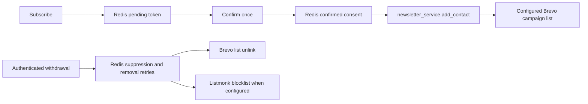

# Newsletter consent and delivery (T-9158 / #261)

`newsletter:confirmed` in Redis is the consent record. Pending signup tokens
are not consent. Confirmation preserves the requested preferences and DOI
evidence; backfill never invents timestamps or changes that evidence.

Brevo is the campaign delivery list. Contact enrollment, monthly reports and
admin campaigns share `BREVO_LIST_ID`, with the existing list default.
`BREVO_API_KEY` remains server-side. Listmonk is an optional secondary provider.
List membership does not replace consent or override provider suppression.

The boundary covered by this change is:

A new confirmation attempts enrollment once. It queues an internal
`newsletter:brevo:add_retry` marker before the provider call and clears it on
success. Failure keeps the consent and the public confirmation response;
only a fixed, redacted error is logged. Consumed links do not repeat enrollment.
Retry through the admin backfill; no background sync job is introduced.

Brevo's bearer-authenticated webhook propagates `unsubscribed` / `unsubscribe`,
`hardBounce` / `hard_bounce`, `spam` and `complaint` events, covering both
transactional and campaign spellings. Operators can also record a withdrawal with
`POST /api/v1/newsletter/unsubscribe` and an email field in its JSON body.
This endpoint requires the existing admin bearer authentication; public
withdrawals use Brevo's unsubscribe flow and authenticated event webhook.

Withdrawal atomically records `newsletter:suppressed`, removes active Redis
consent, cancels pending additions and queues provider removals. Brevo is
unlinked from the configured list, retaining its contact/suppression history;
Listmonk matches the exact address and blocklists it when configured. Repeated
withdrawals are safe. Failed removals remain in `newsletter:brevo:remove_retry`
and `newsletter:listmonk:remove_retry` until retried. Local/provider suppression
wins over confirmation and backfill; no blacklist or unsubscribe flag is reset.
An in-flight addition checks withdrawal again and compensates with removal.

`POST /api/v1/admin/newsletter/backfill` requires
`Authorization: Bearer <ADMIN_KEY>`. Its `dry_run` query parameter defaults to
`true`: read confirmed consent and Brevo state, perform no writes, and return
only `to_add`, `already_present`, and `failed` counts. Suppressed, invalid and
unreadable records count as failed. `?dry_run=false` retries queued withdrawals
and reconciles confirmed contacts; successful additions count as `to_add` and
failed withdrawals also count as `failed`. Repeating apply reports successful
members as already present. Pending signups and provider-only contacts are
outside the backfill scope. Responses/logs contain no contact identities or
credentials.

This documents the implemented handoff, superseding the historical no-writer
inventory in [the delivery audit](newsletter-delivery-audit.md). Campaign
content and preference-based audience selection remain separate work.

Provider operations follow the official
[Brevo list removal API](https://developers.brevo.com/reference/remove-contact-from-list)
and [Listmonk subscriber API](https://listmonk.app/docs/apis/subscribers/);
campaign event names follow [Brevo marketing webhooks](https://developers.brevo.com/docs/marketing-webhooks).
